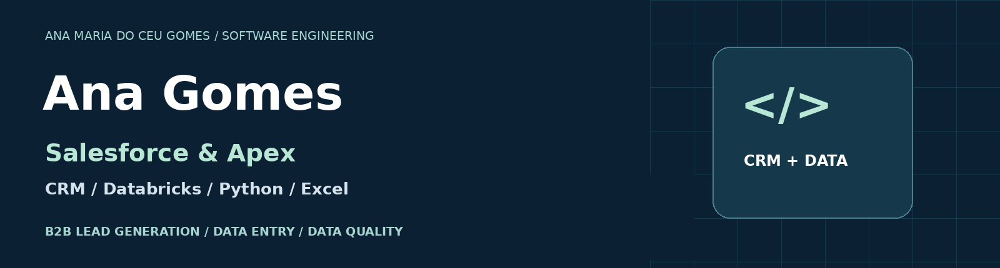
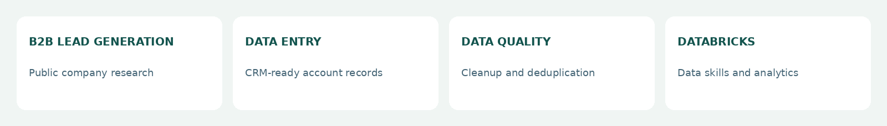
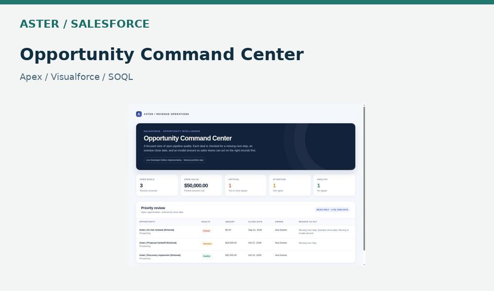
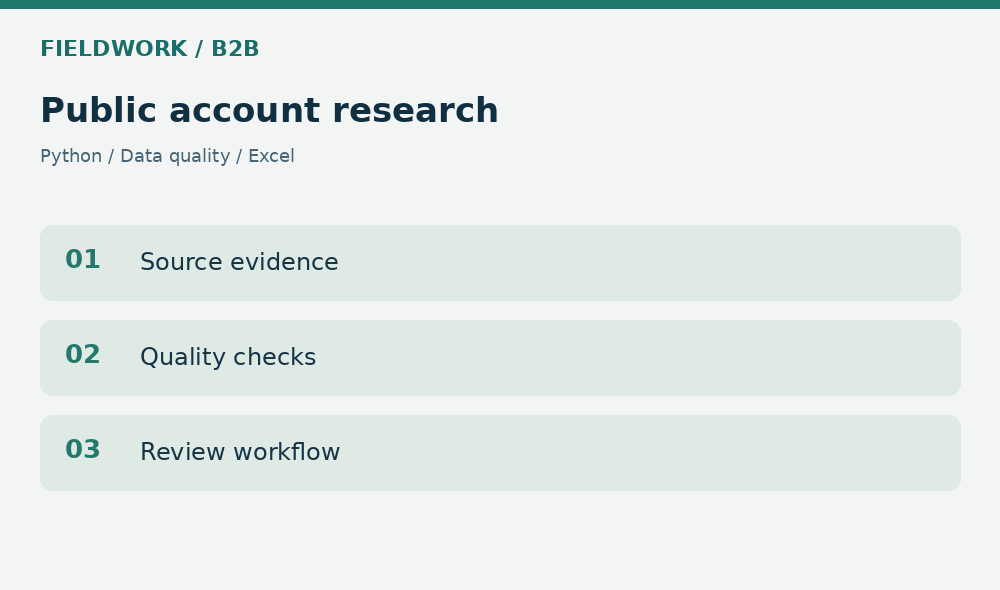
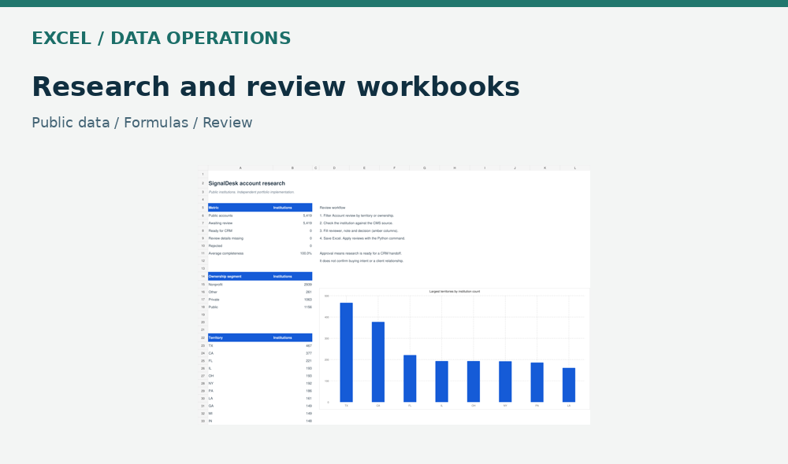
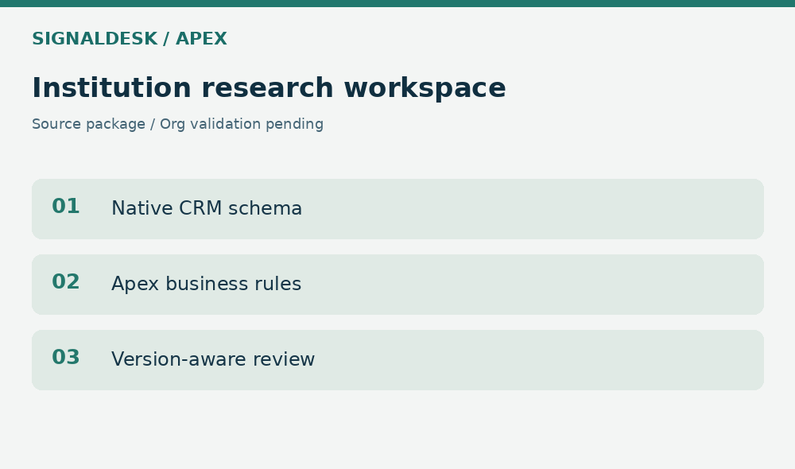

  

  <strong>Software engineering student · CRM development · Databricks · B2B lead generation · Data entry</strong>

  <a href="https://github.com/anaoutro?tab=repositories">Explore my repositories</a> ·
  <a href="https://github.com/anaoutro/crm-data-operations-lab">CRM & Data Operations Lab</a>

## About me

I'm **Ana Maria do Céu Gomes**, a Software Engineering student at UBM in Brazil. I combine programming, CRM configuration and structured data work to make research and business operations easier to review and maintain.

My work includes Salesforce with Apex and Visualforce, Python automation, Databricks experience, public B2B account research, data entry and Excel workbooks and implementation cases for Zoho CRM and HubSpot. I also bring experience in design and audiovisual production; this GitHub profile focuses on my technical and corporate projects.

## CRM & data toolkit

<table>
  <tr>
    <td align="center"> <strong>Salesforce</strong></td>
    <td align="center"> <strong>Apex</strong></td>
    <td align="center"> <strong>Zoho CRM</strong></td>
    <td align="center"> <strong>HubSpot</strong></td>
    <td align="center"> <strong>Python</strong></td>
    <td align="center"> <strong>Excel</strong></td>
    <td align="center"> <strong>Databricks</strong></td>
    <td align="center"> <strong>SQL</strong></td>
  </tr>
</table>

**Development:** Apex · Visualforce · SOQL · Python · SQL  
**Data & operations:** Databricks · Data entry · Data cleanup · Deduplication · Excel · Source traceability

**B2B research & lead generation:** Public-source company research · Account list building · CRM-ready data preparation · Evidence-backed review

**Additional CRM workflow design:** GoHighLevel — automation blueprint; live implementation pending.

## Selected technical projects

<table>
<tr>
<td width="50%" valign="top">

<h3>Aster · Salesforce</h3>

Apex and Visualforce opportunity workspace with a fictional scenario seed and documented Developer Edition evidence.

<a href="https://github.com/anaoutro/crm-data-operations-lab/tree/main/salesforce-aster">Explore source and setup →</a>

</td>
<td width="50%" valign="top">

<h3>Fieldwork · B2B research</h3>

Ten public company accounts, a duplicate-hold workflow, source evidence, Python processing and Excel outputs.

<a href="https://github.com/anaoutro/crm-data-operations-lab/tree/main/fieldwork">Explore research pipeline →</a>

</td>
</tr>
<tr>
<td width="50%" valign="top">

<h3>Excel · Research & operations</h3>

Public research workbook presentation plus separate HelioBook and Lumen planning scenarios. The linked repository contains the scenario workbooks; the cover shows the separate SignalDesk workbook.

<a href="https://github.com/anaoutro/crm-data-operations-lab/tree/main/excel-scenarios">Explore Excel scenarios →</a>

</td>
<td width="50%" valign="top">

<h3>SignalDesk · Salesforce Apex</h3>

Source package for a public-institution review application: custom schema, Apex quality rules and a Visualforce workspace. Repository upload and Salesforce org validation are pending.

<a href="https://github.com/anaoutro/signaldesk-salesforce-apex">Project repository →</a>

</td>
</tr>
</table>

## CRM implementation cases

| Platform | Work presented | Evidence |
|---|---|---|
| Salesforce | Aster opportunity workspace | Apex source and historical Developer Edition validation |
| Zoho CRM | Structured research and account setup | Implementation case documentation |
| HubSpot | CRM workflow setup | Live/developer-test case documentation |
| GoHighLevel | CRM automation workflow design | Blueprint and offline examples; no live sub-account |

[Open implementation evidence](https://github.com/anaoutro/crm-data-operations-lab/tree/main/docs/crm-implementations)

## Databricks & analytics

Databricks is part of my data skills and professional development. My separate [Circular Intelligence repository](https://github.com/anaoutro/circular-intelligence-databricks) is awaiting source publication; it is not presented here as a verified deployed lakehouse.

## How I approach the work

- Preserve public-source evidence and distinguish research priorities from buying intent.
- Separate public datasets from fictional planning scenarios.
- Deliver code, instructions and validation evidence with each technical project.
- Document whether an item is implemented, a prototype or awaiting deployment.

<strong>Project scope and verification</strong>

Aster's documented test result belongs to that application and its historical run. It is not SignalDesk coverage. Public institutions and companies are research subjects, not claimed customers. Zoho and HubSpot case documentation is distinct from the synthetic offline Python examples. GoHighLevel is currently a blueprint, not a live implementation.

---

**Brazil · Intermediate English · Software Engineering at UBM**
